<!-- ===================== BANNER ANIMADO ===================== -->

  

<!-- ===================== TEXTO QUE SE ESCRIBE SOLO ===================== -->

  

---

### Sobre mí

- Estudiante de **Ingeniería de Sistemas e Informática**
- Aprendiendo sobre **desarrollo backend, bases de datos y paradigmas de programación**

---

### Tecnologías y herramientas

  

---

### Proyectos destacados

| Proyecto | Descripción | Stack |
|---|---|---|
| **Red Social de Estudio** | Proyecto final de Bases de Datos: red social para compartir material de estudio. | Python · FastAPI · PostgreSQL |
| **Proyecto Final Paradigmas** | Implementación, diagramas y correcciones del proyecto de Paradigmas de Programación. | — |
| **Universidad** | Proyectos y aplicaciones útiles desarrollados desde primer semestre hasta hoy. | JavaScript |

---

### Estadísticas de GitHub

  
  

  

---

### Mis contribuciones

  <picture>
    <source media="(prefers-color-scheme: dark)" srcset="https://raw.githubusercontent.com/thomassining15-maker/thomassining15-maker/output/github-snake-dark.svg" />
    
  </picture>

---

### Contacto

  
  

<!-- ===================== PIE ANIMADO ===================== -->

  

